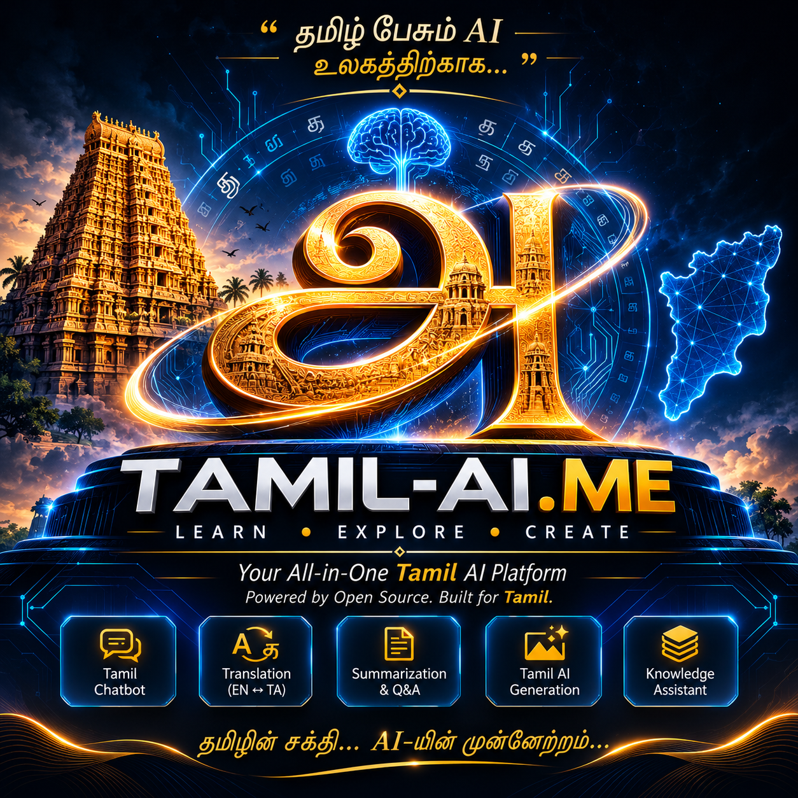
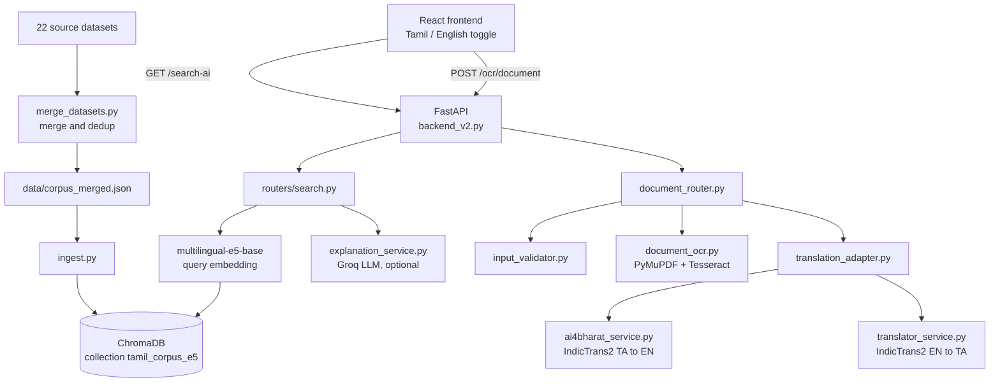
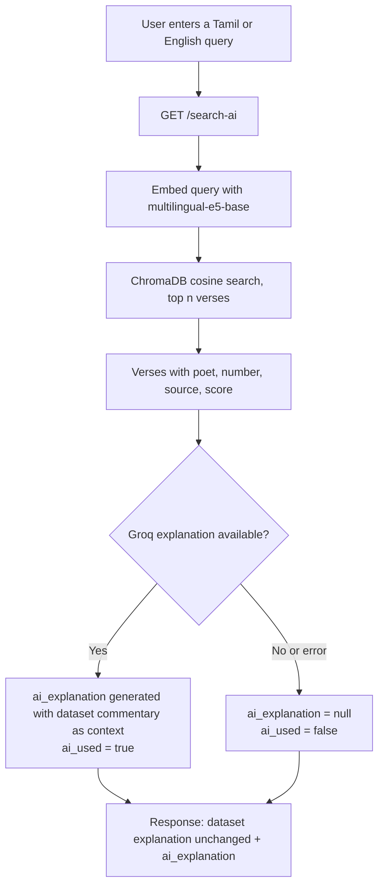
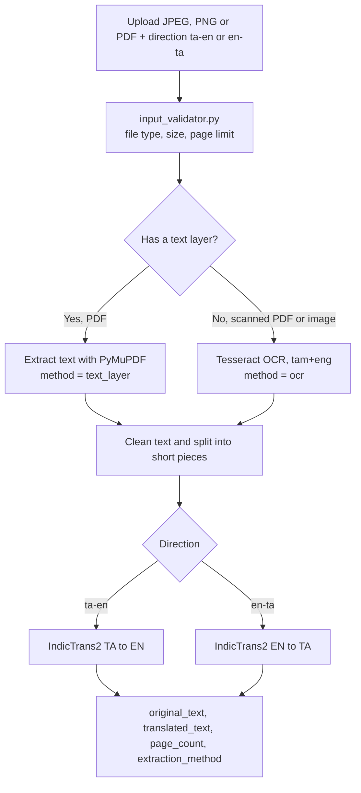

<div align="center">
  
</div>

# 📜 TAMIL-AI.ME

**Search, translate, and understand classical Tamil literature with AI.**
A Tamil-first retrieval and translation platform with a built-in document OCR module (KalVettu).

[](https://www.python.org/)
[](https://fastapi.tiangolo.com/)
[](https://react.dev/)
[](https://www.trychroma.com/)
[](https://huggingface.co/ai4bharat)
[](#-license)

> **TAMIL-AI.ME** is a full-stack platform that makes classical Tamil literature searchable, translatable, and explainable.
>
> It runs semantic search over a merged corpus of 4,592 entries from 22 sources, translates between Tamil and English with IndicTrans2, and reads Tamil documents through an OCR pipeline — while keeping the original source text separate from any AI-generated explanation.

---

## 🌟 Vision

Classical Tamil literature is one of the oldest continuous literary traditions in the world, but most of it is hard to reach with modern tools. TAMIL-AI.ME exists to put this literature, and later Chola-era stone inscriptions, into a form that anyone can search and understand in modern language, with every answer traceable to a real source.

---

## 🧩 Problem Statement

Tamil is a major world language, but it is still a low-resource language for mainstream AI tooling. Classical Tamil text has five specific problems:

1. **The language is hard to read.** Sangam-era poetry and Thirukkural use vocabulary and grammar that differ from modern Tamil. Most readers need commentary to understand a single verse.
2. **The sources are scattered.** The texts live in separate datasets with different formats, duplicate entries, and inconsistent metadata.
3. **Keyword search fails on poetry.** People search by meaning or theme ("separation", "duty of a king"), not by the exact archaic word used in a verse.
4. **General chatbots are unreliable here.** A general-purpose model can give a confident answer about a Tamil poem without any source, and the reader cannot check it.
5. **Printed and scanned Tamil documents are hard to use.** Without OCR and translation, the content cannot be searched, copied, or read by non-Tamil speakers.

### How this project addresses them

| Problem                            | Approach in this project                                                                                                                                                                     |
| ---------------------------------- | -------------------------------------------------------------------------------------------------------------------------------------------------------------------------------------------- |
| Scattered, inconsistent sources    | `merge_datasets.py` merges 22 sources into one deduplicated corpus with poet, verse number, and source metadata                                                                              |
| Keyword search misses meaning      | Semantic search using `multilingual-e5-base` embeddings and a ChromaDB cosine collection                                                                                                     |
| Archaic text is hard to understand | Dataset commentary is shown as-is, with an optional AI explanation shown separately                                                                                                          |
| Unsourced or invented answers      | Answers come from retrieved verses. Dataset text is never rewritten. The AI explanation is a separate field with an `ai_used` flag, and the API falls back to plain results if the LLM fails |
| Language barrier                   | IndicTrans2 translation in both directions (Tamil → English, English → Tamil)                                                                                                                |
| Scanned or image-only documents    | KalVettu Document OCR: PDF text layer first, Tesseract OCR (`tam+eng`) as fallback, then translation                                                                                         |
| Undigitized inscriptions           | Chola-era inscription OCR is planned as the next KalVettu stage (see [Planned](#-in-progress--planned))                                                                                      |

---

## 🎯 Purpose

- Make classical Tamil literature searchable by meaning, not only by keyword
- Reduce hallucination by grounding every answer in retrieved source text
- Break the language barrier between Tamil and English for literature and documents
- Digitize Tamil documents and, in later stages, historical inscriptions
- Run on a single consumer GPU (RTX 3050, 6 GB) so the system stays reproducible for students and researchers

---

## 🏗 Architecture



**Design principle:** retrieval is the source of truth. Dataset verses and commentary are returned untouched, and the LLM explanation is a separate, optional field that can fail without breaking the response.

---

## 🔄 Workflow

### Search



### Document OCR and translation (KalVettu)



---

## 📁 Current Repository

```
Project-TAMIL-AI.ME/
├── backend_v2.py              # FastAPI app, CORS, model startup, router registration
├── routers/
│   └── search.py              # GET /search-ai
├── document_router.py         # POST /ocr/document
├── document_ocr.py            # PDF text layer + Tesseract OCR
├── input_validator.py         # file type, size and page limits
├── translation_adapter.py     # chunked translation, one request at a time
├── ai4bharat_service.py       # IndicTrans2 Tamil → English
├── translator_service.py      # IndicTrans2 English → Tamil
├── explanation_service.py     # optional Groq explanation
├── schemas.py                 # response models
├── config.py                  # upload limits and allowed directions
├── merge_datasets.py          # merge and dedup the 22 sources
├── ingest.py                  # load corpus into ChromaDB
├── data/
│   └── corpus_merged.json     # merged corpus, 4,592 entries
├── test_merge_dedup.py        # dedup acceptance tests
├── test_translate.py          # translation smoke test
├── old_unused/                # retired duplicate modules
└── frontend/
    └── tamil-ai-me-frontend/  # React app, Tamil / English toggle
```

_The tree lists the main files only. `old_unused/` holds retired code kept out of the import path._

---

## ✅ Current Features

- Semantic search over 4,592 entries from 22 sources: the Sangam corpus (Akananuru, Kalithogai, Kurunthogai, Narrinai, Purananuru, Paripadal, Pathirruppattu, Pattinapalai and others), Thirukkural, and Naaladiyar
- Search results include poet, verse number, source, and similarity score
- Dataset commentary is returned unchanged, with a separate optional `ai_explanation` and an `ai_used` flag
- Tamil ↔ English translation with IndicTrans2 distilled 200M models, running on GPU
- Document OCR and translation for JPEG, PNG, and PDF files (up to 5 MB and 5 PDF pages), with text-layer detection before OCR
- Corpus merge and dedup pipeline with passing acceptance tests
- Bilingual web frontend with search and KalVettu document pages
- Local model inference: only the optional explanation step calls an external API

---

## 🚧 In Progress / Planned

**Known issues**

- Translation quality on long Tamil PDFs needs improvement
- The AI explanation can drift from the dataset commentary

**Planned**

- Chola-era stone inscription OCR with OpenCV preprocessing and a fine-tuned OCR model (approach not finalized)
- Inscription explanation layer on top of the OCR output
- Route-level tests for `/search-ai` and `/ocr/document`
- Voice input and output (speech-to-text and Tamil text-to-speech), limited by the 6 GB VRAM budget
- Free-tier cloud deployment with a public demo endpoint
- Integration with the JARVIS voice assistant through a `tamil_query` intent

---

## ▶ Run

### Prerequisites

- Python 3.10 and a CUDA-capable GPU (developed on an RTX 3050 with 6 GB VRAM)
- [Tesseract OCR](https://github.com/UB-Mannheim/tesseract/wiki) 5.x with the Tamil language data (`tam.traineddata`)
- Node.js and npm
- A Groq API key (optional, only needed for `ai_explanation`)

### Backend

```bash
git clone https://github.com/ajeem-suban/Project-TAMIL-AI.ME.git
cd Project-TAMIL-AI.ME

conda create -n tamil-ai-310 python=3.10 -y
conda activate tamil-ai-310

pip install torch==2.3.1 --index-url https://download.pytorch.org/whl/cu121
pip install "transformers==4.40.0" "numpy<2"
pip install -r requirements.txt

# Build the corpus and load it into ChromaDB
python merge_datasets.py
python ingest.py
```

Start the server without `--reload`. Reload mode loads the models twice, which does not fit in 6 GB of VRAM.

```bash
uvicorn backend_v2:app
```

Interactive API docs: `http://127.0.0.1:8000/docs`

On the first run, set `HF_HUB_DISABLE_XET=1` so the Hugging Face models download correctly. After the models are cached, `HF_HUB_OFFLINE=1` runs the server fully offline.

### Frontend

```bash
cd frontend/tamil-ai-me-frontend
npm ci
npm run dev
```

The app opens at `http://localhost:8080`. Use `npm ci` so the pinned lockfile is respected.

### Example request

```bash
curl "http://127.0.0.1:8000/search-ai?query=love%20and%20separation&n=3"
```

Each result contains `tamil`, `translation`, `explanation`, `ai_explanation`, `poet`, `number`, and `score`.

---

## 🙏 Acknowledgements

- [AI4Bharat IndicTrans2](https://github.com/AI4Bharat/IndicTrans2) for Tamil ↔ English translation
- [Hugging Face](https://huggingface.co/) for the model hub and Transformers library
- [ChromaDB](https://www.trychroma.com/) for the vector store
- [Tesseract OCR](https://github.com/tesseract-ocr/tesseract) for Tamil OCR
- [Groq](https://groq.com/) for the optional explanation model

---

## 🔗 Connect

Built by **Ajeem Suban**, B.Tech Artificial Intelligence and Data Science, Dhanalakshmi Srinivasan University.

[](https://github.com/ajeem-suban)
[](https://www.linkedin.com/in/ajeem-suban/)
[](https://huggingface.co/AJEEM-SUBAN)
[](https://ajeem-suban.vercel.app)
[](mailto:ajeemsuban060@gmail.com)

---

## 🤝 Contributing

Fork → Branch → Commit → Pull Request

---

## 📜 License

MIT

---

_A reliable, source-grounded Tamil AI platform that makes classical Tamil literature and inscriptions searchable for everyone._
